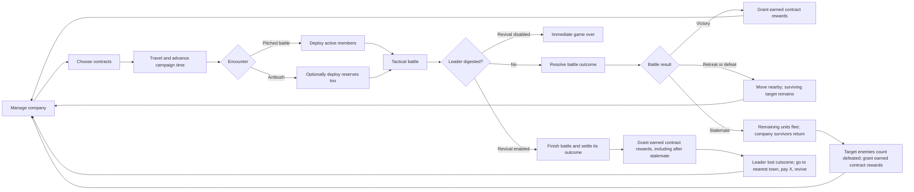

# Mercenary Company Campaign Revamp

**Status:** Agreed design and staged migration. The user accepted 03B2. 03B3A prepares old override loading for definition retirement and corrects new leader/morph defaults, with compilation/scene checks passed and interactive review accepted. 03B3B review advances 05A1 before prototype removal. Stat/graphics/resources, legacy providers, species curation and the company campaign remain later work. See roadmap/checkpoint for current state.

**Delivery plan:** See [the phased conversion roadmap](conversion-roadmap.md) and its separate specifications for the editor baseline, comprehensive architecture study, feature/content retirement, new campaign implementation, and later expansion. This document remains the design record.

**Latest decisions:** [The 2026-10-30 clarification record](design-clarifications-2026-10-30.md) records all 24 answers after packet 01C, current species-toggle behavior, and resolved follow-ups. The no-abandonment, actual-outcome, and stalemate rules below explicitly supersede earlier left-behind-loss statements. Numeric examples remain tuning work rather than implementation defaults.

**Project context:** VoreWar is a Unity 2018.3.12f1 project. The current campaign is an empire-scale strategy game connected to tactical battles. No OpenSpec structure is present in this checkout, so this lightweight planning document is the working record for now.

## Purpose

Shift the main game from empire and multi-army conquest toward an open-ended, single-player mercenary-company RPG. There is no required final victory objective. The campaign is about keeping the company alive and making its individual members matter.

The intended loop is contracts, travel, encounters and battles, then company recovery and management. The player leads one company against AI-controlled opponents. The conversion has two intended modes: the mercenary-company campaign and Pure Tactical, a single-battle sandbox. Traditional Vore War empire gameplay is retired.

## Confirmed direction

### Campaign and company

- Replace the empire-conquest campaign map with a finite RPG world map procedurally generated anew for each mercenary campaign, reusing the existing grid-map system where practical. Use fog of war that reveals nearby tiles as the company travels. Towns are mostly discovered through exploration or contract leads. The player company is the only moving strategic force; villages remain static. Accepting a contract reveals its target's exact world-map tile, even if that tile is under fog. For the MVP proof of concept, map locations are limited to towns and contract targets; other points of interest may be added later.
- Retire village ownership, population simulation, construction, research, diplomacy, multiple player armies, and conquest victory conditions from the main campaign.
- Towns remain useful as locations, and every town has all core services. The company can find work and recruits, buy gear, recover, and access leader-revival services there. Rest is possible anywhere but provides better recovery in towns; paid treatment speeds injury recovery. Town ownership and city management are out of scope unless reintroduced explicitly.
- The player commands one company. Mercenaries have names and distinct generated appearances; visual customization is removed for them, but renaming remains available as a nickname. At new-campaign creation, the player customizes the company leader's species, appearance, and name. MVP species come from the existing roster and retain their VoreWar stats, talents, and abilities (for example, Avian Featherweight or Frog leaps). A starting focus such as melee, archer, or mage shapes the leader's initial stats and gear and likely grants a small bonus through the existing Trait system, such as improved melee damage, ranged damage, or magic. Later growth remains flexible. Species have strong natural specialties, but those do not lock a character to a role. Disable the existing species roster at code level across both modes initially, then curate and re-enable species individually as the user selects them. The user has supplied a list of entries for outright removal to the fullest degree practical; see [species-curation-checklist.md](species-curation-checklist.md). The remaining species dispositions will be decided later. The MVP playable cast should be very small, roughly one sapient species suited to each of melee, ranged, and magic. Add more species in later development updates, not as campaign unlocks. Do not require the user to approve the entire roster at once.
- The leader creator and ordinary recruit pool use the same approved playable sapient species list. Sapient species can serve as leader, mercenary, enemy, or (later) random encounter. Non-sapient animal species can appear as enemies, random encounters, or temporary magical summons, but cannot be company members; the MVP animal roster should also start small and grow over time. The generic creature-summoning spell uses animals only, but temporary sapient clones, doubles, or illusions are acceptable. Named unique characters from the current roster are removed from the conversion. Deprecate permanent animal-polymorph spells and the excluded conversion mechanic. No mid-battle conversion or spontaneous allegiance switching; future rescue/hiring events may instead offer a salary and require explicit player consent.
- Replace the legacy Merc / Monster Spawning page with global species-availability settings shared by both modes. Players can block newly generated individuals of curated species, but cannot enable a species that has not been curated and added. Preserve all existing individuals, including the leader, recruits already offered, former members, and existing contract enemies. Reappearance/rehire is not new generation. No campaign-start lock is required. Legacy mercenary flags select future candidates, whereas disabling monster spawners can clear existing world-map armies; do not inherit that destructive side effect.
- There is no fixed company roster limit, but the intended company remains small and should rarely exceed five or six total members, including the leader. Wages and upkeep constrain further growth.
- A new campaign starts with the leader alone in a procedurally generated town. The starting recruit pool offers a few candidates with clear variety in species and backstory; all are inexperienced and affordable. Starting cash supports about two hires, not the whole pool. Early recruits have a basic weapon but no armor or accessories; early opponents should also be poorly equipped.
- Recruitment should present prospective members as individuals in a small, named pool unique to each town. When the pool refreshes, unchosen candidates leave and new candidates replace them. Each candidate gets a short backstory that is mainly for flavor. Company-wide reputation is shown as a numeric value and controls which recruit power bands can appear: at certain reputation values, candidates with higher power (level, stats, and starting gear) become eligible. Higher reputation reveals more and better candidates.
- The roster supports active and reserve status. Members can be prepared in advance, but every battle has a final deployment overview where the player can make last-minute changes and inspect the generated enemy roster, including each enemy's weapon when they carry one. Campaign battles allow up to eight active members, including the leader; mark any others as reserves before battle. The company roster remains unlimited. The company leader must participate in every battle, regardless of roster status.
- Non-leader mercenaries receive wages, including members who are injured or in reserve. The player character works for free. Each mercenary has a quoted weekly wage that rises as they level. Wages are paid in advance, with the first payday seven days after campaign start and subsequent paydays every seven days. Hiring midweek costs a prorated amount for the remaining days of that week, followed by the next regular payday. Wages also represent rations and daily communal needs, so there is no separate upkeep bill.
- When payday is missed, a dialogue reports the problem and each mercenary's unpaid amount becomes personal debt. If the treasury cannot cover everyone, do not automatically pick recipients: record unpaid wages as debt and let the player choose. Show current gold, total debt, shortfall, and imminent departure warnings. Offer an explicit button to pay all threatening members' full debts (only if affordable), View Company for individual full payments, or OK to return to the map without paying. If a mercenary remains unpaid at another payday, another full weekly wage is added to their debt. Veterans can warn that they will leave unless paid, giving the player a one-day grace period. Debts must be paid in full, with no partial payments. If the day elapses and a warned mercenary still has debt, they leave with a follow-up dialogue. Multi-day rest pauses for these warnings and other decisions requiring a response. Less experienced, lower-paid recruits may tolerate debt longer because they need work and experience; their departure threshold remains undecided.
- Mercenaries who leave do not disappear. Former members remain persistent, retain their full state and personal debt, and do not count against the ordinary town candidate pool. They can reappear as candidates in any town; check for them when the player enters a town rather than simulating their travel. Rehiring requires paying their outstanding debt in addition to normal prorated wages.
- The company can hold several contracts at once, with no single contract receiving higher priority. New contracts can be accepted at any discovered town; offers vary by location and should include nearby work. Each town has a limited contract pool that refreshes over time, discouraging the company from remaining indefinitely in one place. The starting town offers multiple low-difficulty contracts. Company reputation unlocks harder contract offers. Reputation changes only through contract outcomes and does not decay over time. Each contract has a visible numerical difficulty rating representing a fixed enemy power level, independent of company strength. A procedural enemy-force generator assembles units, levels, abilities, and equipment to meet that rating's target power within a tight range; forces at the same rating vary mostly in composition and never exceed eight members. Higher ratings should improve levels, role traits, weapons and armor before increasing enemy headcount, while keeping sapient squad members near one another in level. Some species may use a swarm profile with individually lower HP or strength than typical units (roughly half is one possible scale), allowing more members within a similar total power budget. Enemy squads should not need to be hand-curated. The opening offers are rout-the-force contracts. After the three opening contracts, a standard four-offer town refresh includes one “Rout the boss” objective when an enabled sapient species is available. The boss is explicitly identified, receives a larger share of the same fixed rating power budget, is one level above contract rating, and always carries both a ranged and melee weapon. The contract is complete when the boss is downed, digested or flees; other enemies keep their actual battle outcomes and use only their normal retreat behavior. Success still counts if the player retreats. Other rout-the-force contracts keep their existing objective. All contracts have a fixed, generous deadline. On the map, each contract marks its target location. Completing the contract triggers its reward automatically, with no return trip required. Initial-version rewards are gold only. The gold payout is based on contract rating with a modest random margin, rounded to a multiple of ten; the exact payout is shown on the offer. A powerful company may take a weak contract, but its payout can be insufficient to cover the wages incurred during the time spent. Every completed contract increases company-wide reputation. Failing the objective in time harms reputation; abandoning a contract carries the same penalty as missing its deadline, scaled by contract difficulty. When a contract expires, its target disappears. Reputation gain scaling is still open; avoid assuming an exponential formula because it may grow too quickly. Exact gain/loss amounts and the payout formula remain undecided.
- HP recovery should take time. Injuries should be meaningful. HP recovery and sparring experience for all healthy mercenaries, active and reserve, make small gains each day. Rest advances a player-selected number of days and provides extra recovery. Preserve the current level-up system. The current paid army-training action is expected to leave.
- Expand equipment to nine dedicated slots: helmet, torso armor, leg armor, arm armor, accessory (ring/amulet), melee weapon, ranged weapon, and two spells. Keep melee/ranged action keys 1 and 2; each attack automatically uses its corresponding equipped weapon. Visible armor changes are not a current goal. Equipment can be changed anytime outside battle. Maximum-HP equipment adjusts current and maximum HP together on both equip and removal; preserve symmetric adjustments without repeatable free healing. Potion gameplay is expected to be removed. Battlefield gear loot remains undecided; the user leans toward equipment being destroyed with a digested member.
- A separate tracked supply inventory is not a priority. Regular company expenses can be framed as “wages and upkeep.”
- The mercenary campaign should retain a random-event capability for company-focused happenings, including events on the road and sudden ambushes. All existing event content is tied to the 4X game and is to be removed from the conversion. Review the event framework before deciding what generic machinery can be reused; new event content and its timing relative to the core contract loop remain to be planned.
- Company wipeout is a loss condition. There is no empire-conquest win condition. After a campaign-ending wipeout, show a run summary with company reputation, total gold earned, mercenaries hired, mercenaries lost, contracts completed, days survived, and enemies defeated. The lost count includes only fallen mercenaries recorded in the memorial; dismissed or departed mercenaries do not count.
- Keep a memorial page accessible during the campaign and after it ends. It records fallen mercenaries and their actual final fates, such as being digested. There is no left-behind state or assumed off-screen loss. Dismissed, departed, fled, and surviving stalemate participants are not memorialized.
- Campaigns use normal save and reload, with in-battle saving desired and between-battle saving an acceptable initial technical fallback. Optional Ironman is selected and locked at campaign creation; aim for turn-by-turn saves and several corruption-recovery backups, with exact feasible boundaries assessed in packet 01D. The conversion uses new campaign saves only; importing existing empire-campaign saves is out of scope.

### Combat and injuries

- Preserve vore and digestion combat mechanics in full, virtually unchanged. Characters are expected to be at real risk of being vored and digested as HP gets low; reaching 0 HP without being vored is not guaranteed. Vore/digestion outcomes remain their own combat outcomes and are not replaced by the downed-at-0-HP rule.
- Preserve the enemy tactical battle AI and the basic tactical battle loop.
- In both modes, replace every surrendered state/presentation with “downed.” Reaching 0 HP always downs a persistent unit unless a final digestion outcome takes precedence; fear/pain effects can also down units above 0 HP. Downed units cannot receive or execute commands for the remainder of battle, even if healed. Summons disappear instead of becoming downed. Remove the player-facing surrender button. Ordinary attacks do not deliberately target downed units, but area effects can reach them without permanently killing them; consumption succeeds against them with 100% chance. Digestion is the only way to permanently remove an otherwise persistent character. Surviving downed company members return at low HP with injuries retained on victory or stalemate. There is no left-behind state or assumed loss on retreat/defeat; this supersedes earlier statements.
- Downed or contained living units do not normally end a battle: continue until one side's units are all dead, fled, or digested. When only downed company members remain against standing enemies, the battle continues through actual consumption/digestion rather than declaring an assumed loss. Preserve the existing automatic battle simulation so the player can delegate the remainder, with AI prioritizing consumption of downed enemies. Declare stalemate when both sides have zero active units or the fight remains unable to finish after an excessively generous turn limit (200 turns is illustrative). All remaining units count as fled and go home; downed survivors are not lost. Enemies cannot flee with swallowed captives: release them first or prevent retreat, including when resolving a draw. Fled enemies are removed and count as defeated even during stalemate; completing the target this way still grants normal contract rewards. Failed attempts that leave an actual surviving target preserve its casualties/wounds and daily HP recovery; do not regenerate the original squad.
- Permanently deprecate legacy resurrection, reincarnation, replacement, and saved-copy effects that bypass loss. The leader's optional paid cutscene is the sole intended revival.
- Spell/trait healing may remain in a separate temporary combat HP pool, visibly distinguished, not decaying over time but removed at battle end. Damage spends temporary HP first. Vore healing raises lasting HP and survives battle end; do not undo it with a lowest-total-HP reset. Remove automatic full-heal result behavior. Caps and injury interactions need refinement. Critically injured survivors receive a modest post-battle minimum HP baseline after temporary HP clears (10% or 20% are examples, not a chosen value), separate from full recovery or resurrection.
- Add possible status effects for certain damage types.
- Small injury chances may apply across weapon, digestion, poison, spell, and environmental damage, rather than weapon hits alone.
- Add temporary and lasting body-part injuries, described in accessible terms such as “injured hand” or “injured arm.” Injuries should mostly create numeric combat penalties, such as reduced movement, accuracy, or damage. Minor injuries recover primarily through daily time and rest, then clear completely.
- Serious-injury chances are checked both on damaging hits and after deep attrition. A serious injury acts as a strong debuff while the mercenary recovers; after recovery, it becomes a permanent “old injury” that lowers the related combat stat and can stack. For example, a near-death injury could heal into trembling hands that reduce ranged accuracy. The temporary serious-injury penalty is stronger than its eventual old-injury penalty. Reaching 0 HP does not guarantee an injury and is not significantly more dangerous for injury risk than reaching 1 HP; a unit may go down from pain or fear without lasting damage. The leader is exempt from permanent injuries. Armor reduces injury risk. Start with random body-part selection; later it may be weighted toward unarmored body parts. HP should represent meaningful attrition rather than something erased with potions.
- Paid treatment is charged per injured mercenary and reduces the days needed for temporary injuries to recover. It cannot repair old injuries.
- Injuries affect combat in both modes. Recovery, treatment, serious-injury progression into permanent old injuries, and other persistent character consequences apply only to the mercenary campaign. Pure Tactical is one battle with no continuing characters or retained stats; battle results and injuries are discarded when it ends.
- Injury presentation should be less graphic than Battle Brothers. Do not use amputation or emergency-room-style descriptions.
- Preserve generated visual identity for ordinary mercenaries, while allowing the player to customize the company leader during new-campaign creation.

### Vore and digestion narrative rewrite

- Preserve the vore and digestion gameplay mechanics that remain in the conversion; rewriting narrative text does not authorize changing their behavior or balance.
- Before editing text, trace how vore- and digestion-related flavor text is stored, selected, and displayed. Inventory the relevant strings and their contexts so the replacement work covers the full player-facing narrative rather than only obvious combat messages.
- Replace the existing narrative prose with the simplest neutral placeholder strings needed to keep the remaining mechanics readable and functional. The user will write all replacement narrative from scratch later; do not invent replacement flavor text.
- For vore types or related features removed from the conversion, remove their associated narrative where practical. If a type or mechanic remains but its narrative is not ready to be rewritten, a basic placeholder may remain indefinitely.
- Keep this work distinct from the gameplay migration: preserve mechanics unless a separate design decision retires them, and treat prose replacement as its own planned task.

### Player character and revival

- The player has a company leader who fills the role of the current Empire Leader counterpart and receives no wages.
- The leader uses the same leveling framework and equipment systems as other mercenaries, with greater personal starting stats and/or growth to make them tougher. Deprecate Leadership, its aura, and automatic growth; do not reserve it for an invented company mechanic.
- The leader's name and appearance cannot be changed after campaign creation.
- The leader can suffer temporary injuries, which can recover over time, but can never suffer a permanent injury. After revival, the leader returns fully intact at full health.
- If the leader is digested but other company members survive, the remaining company members go to the nearest town for revival when that option is enabled. Reserves count as surviving company members. Losing the leader when no company members remain is company wipeout. The leader alone has this unique immortality; other characters cannot use the service.
- If leader revival is disabled, the campaign ends immediately when the leader is digested. Merely being downed triggers neither revival nor game over; the surviving leader receives the ordinary low-HP survivor baseline.
- The player can change the leader-revival option anytime in campaign settings.
- If leader revival is enabled and the leader is digested during a battle:
  1. Let the battle finish.
  2. Resolve actual battle outcomes and grant earned contract/quest rewards, including when stalemate flight completes the target. Ordinary gear loot remains a separate open decision.
  3. After battle results are settled, enter a “Company Leader lost” cutscene.
  4. The cutscene explains that the company hurried to the nearest town and paid for revival services. The fee is a base amount multiplied by the leader's level.
  5. Revival still happens if the company cannot afford the fee. The payment may leave the company with insufficient funds for wages, creating a serious ongoing financial problem.
- The forced trip is a cutscene transition only; it does not advance campaign time or trigger normal time-based systems.
- The base revival fee is still undecided.
- Preserve VoreWar's tactical retreat mechanic: reach the edge of the tactical map and click Retreat. A successful retreat moves the company to a nearby world-map location. A surviving contract target remains available for another attempt before its deadline.

## Working loop

The world map should retain the existing grid-map structure where practical, but strategic movement is centered on the player's company. Fog of war reveals nearby tiles as the company travels. Towns are mostly discovered through exploration or contract leads; accepting a contract reveals its target's exact tile even through fog. Villages are stationary locations. Moving the company onto a contract target starts combat, as moving an army into another army or occupied town does currently. Tactical battles resolve in zero campaign time: the campaign clock and its daily systems do not advance during combat. Battlefield terrain should continue to be generated from the world-map tile as VoreWar currently does; grassland and desert are known examples, while the exact tile-to-battlefield rules should be checked during implementation. The campaign uses turns with a consistent action budget each day (10 actions is an example, not a fixed value). Moving one map square costs actions; some terrain costs additional movement actions. Interaction action costs should be configurable and default to zero, so selected interactions can be made action-costly later without redesigning the system. Current examples under consideration are entering a town, viewing the hire pool, and visiting a merchant; purchases and accepting contracts do not cost separate actions. Other service costs are deferred. The player chooses when to end the turn, but cannot take actions after the budget reaches zero. Each turn represents one day. Weekly wages are paid in advance, with the first payday seven days after campaign start, and midweek hires pay prorated wages before joining the next payday. HP and healthy-member sparring make small daily gains. Rest advances a player-selected number of days by automatically skipping those turns. All daily systems continue during skipped days, including wages, contract deadlines, healing, and recruit-pool refresh. Towns provide better recovery, and paid treatment speeds injury recovery.

## Architecture findings and proposed boundary

The source study is now collected in packets [01A](architecture/01a-navigation-and-settings.md), [01B](architecture/01b-species-events-and-narrative.md), [01C](architecture/01c-combat-equipment-and-results.md), and [01D](architecture/01d-campaign-persistence-and-identity.md), with a [consolidated removal sequence/risk register](architecture/01d-removal-sequence-and-risks.md). The final packet proposes a new explicit campaign save/mode, canonical character identities, resumable daily/results transitions, persisted discovery, and a reviewed tactical snapshot boundary. These are proposed technical owners, not implemented systems or new gameplay balance decisions.

The current build uses `Assets/base.unity` with modes and screens switched by `Assets/Scripts/Core/GameManager.cs`. Campaign data is centered on `World`, `Empire`, `Army`, `Village`, and `Unit`.

- `World` currently stores turn order, empires, villages, map data, and tactical save data.
- `Empire` currently combines faction identity, AI, diplomacy, buildings, research, income, upkeep, and armies.
- `Army` contains units and also owns strategic position, movement, and healing behavior.
- `Unit` already contains names, stats, HP, experience, traits, equipment, and appearance.
- Species content is spread across the `Race` enum, the central `Races` registry, race parameters, graphics, and race-specific clothing. The enum groups entries into main races (starting at 0), mercenary races (50s), monsters (100s), and named unique mercenaries (170s); this whole roster needs curation before campaign use. These are implementation groupings, not the new sapient/animal taxonomy. The current entries are inventoried in [species-curation-checklist.md](species-curation-checklist.md).
- `TacticalMode` accepts armies and a village context; it currently deploys all units in each army and includes village/garrison-related behavior. Preserve the current campaign behavior of starting a battle when one army moves into another army or an occupied town, adapting it to the company moving onto a contract target. Before combat, show the generated enemy roster and the weapon each enemy carries, followed by the player's final active/reserve selection. Preserve the current behavior of selecting battlefield terrain from the world-map tile; verify its exact rules (at least grassland and desert are known) when implementing.
- `ITacticalAI` and strategic AI are separate concepts. Tactical AI is a preservation target; empire-turn strategic AI is tied to the campaign systems being retired.
- Contract enemy groups need a procedural generator driven by a fixed numerical power budget. A rating model must account for each unit's level, stats/species abilities, and equipment, then add members and gear until the target rating is met within a tight allowed margin, varying composition more than total power.
- Saves are Odin-serialized `World` data with version handling in `State`. The redesigned campaign starts with new saves only; importing old empire-campaign saves is out of scope.

### Proposed campaign boundary

A new company/campaign model should own the generated world, clock, current location, contract state, treasury, the canonical mercenary roster and each member's persistent wage debt, active/reserve status, injuries, campaign rules such as leader revival, and memorial records of fallen members and their final fates. The existing `Unit` combat data and tactical AI should be reused where practical.

Battle setup should pass selected company members into tactical combat and reconcile the results back to the same persistent members. Persistent injuries should be represented separately from short-lived tactical `StatusEffect`s so they survive between battles and can be treated or age into “old injuries.” Exact injury rules are not set here.

Town services can be represented as location features without preserving village population, ownership, or construction simulation. Procedural terrain and movement code may be reusable, while empire placement, village economy, and strategic turn scheduling need replacement.

## Screen and feature disposition

| Current feature or screen | Working disposition |
|---|---|
| Main menu and new-game flow | Rework around new company campaign creation, leader customization, and new campaign saves. |
| Strategic map | Make this the main screen between actions; rework it as a procedural RPG travel map with fog, towns, contracts, and encounter locations. Keep a persistent active-contract list beside the map. |
| Town services | Entering a town opens a dedicated hub for its core services. |
| Villages, buildings, research, diplomacy, and empire turn reports | Retire from the main campaign. |
| Player army controls | Rework as a company roster and management screen accessible from the world map anytime outside battle, with active/reserve selection. |
| Recruitment and mercenary houses | Rework as individual candidates with backstories and company hiring. |
| Equipment, inventory, shops | Keep and expand for full company-member loadouts; do not prioritize a separate supply inventory. |
| Potion system | Remove from the intended game. |
| Paid army training | Replace with passive sparring during downtime for healthy members. |
| Tactical combat and enemy battle AI | Keep; add a final deployment overview before every battle showing the generated enemy roster and held weapons, followed by the player's final active/reserve selection, and a post-battle results summary; adapt encounter context, injury results, and post-battle flow. |
| Vore and digestion | Keep the gameplay mechanics virtually unchanged. Trace and replace the existing narrative prose with basic placeholders for the user to rewrite; remove text associated with types/features retired from the conversion where practical. |
| Unit renaming | Keep for ordinary mercenaries; leader name is fixed after creation. |
| Player-facing visual customization | Remove for ordinary mercenaries; customize the leader during new-campaign creation, then lock name and appearance. |
| Map Editor, Empire Traits, Cheat Menu, World Settings, Bestiary | Remove from the conversion. |
| Race Editor | Retain for the user behind their secret developer password, with General Options, Trait Options, and Unit Tags Options available. |
| Randomizer/Custom/Conditional Trait Editors, Assimilable Traits, Unit Editor, Variable Editor | Remove as editing tools; retain the underlying Trait system and any data/runtime behavior required by the new game. See [screen-curation-checklist.md](screen-curation-checklist.md). |
| Unit Tag Editor | Keep its editing functionality within the Race Editor's Unit Tags Options tab; remove standalone access elsewhere. |
| Tutorial and cheats | Remove from the intended player flow. |
| Help Screens | Rewrite to explain the new gameplay; defer until later in the conversion. |
| Content Settings | Keep as global settings shared by both modes. Remove the Strategic Gameplay, Building Settings, Tactical Misc, and Vore Misc pages; likely remove legacy Fog of War settings; replace Merc / Monster Spawning with curated-species availability; keep Gender and Appearance Settings as-is; keep balance values code-tunable without player-facing controls; retain cosmetic tactical controls and the current general Options; remove selected Vore Main and Post-Vore controls and leave unlisted controls at current defaults for now. Track details in [options-curation-checklist.md](options-curation-checklist.md). |
| Pure Tactical mode | Keep as a stand-alone single-player skirmish: one battle, no campaign progression or persistent characters/stats. Retain its current attacker/defender setup, AI-versus-AI and bulk matchup testing, map size and terrain selection, using only globally curated and enabled species. |
| Advanced settings | No separate generic Advanced Settings screen was identified in the current menu inventory; the Vore Advanced Content Settings page is covered above. |
| Save/load | Support normal campaign saving and reloading, with optional Ironman locked at campaign creation; use a new campaign save format. Pure Tactical has no continuing campaign state. |
| Campaign ending and memorial | Keep the fallen-member memorial accessible during and after the campaign. After company wipeout, show a run summary with reputation, total gold earned, mercenaries hired and lost, contracts completed, days survived, and enemies defeated. Count only memorialized fallen mercenaries as lost. |
| Events and random encounters | Remove all existing 4X event content. Review whether the generic event framework can support new mercenary-company events; retain or rework it for new happenings such as road incidents and sudden ambushes. Exact content and timing remain undecided. |

## Expected migration areas

The following changes are anticipated parts of the redesign, not unexpected scope growth:

1. Introduce a campaign/company data model and decide how it is saved.
2. Replace empire turns and ownership simulation with campaign-time travel, contracts, and location services.
3. Rework the roster, recruitment, equipment, individual wage/debt handling, recovery, and downtime progression screens and rules.
4. Adapt battle entry and result handling to active/reserve status, encounters, persistent injuries, and leader death.
5. Build numerical contract difficulty and procedural enemy-force generation from unit, ability, level, and equipment power.
6. Add the leader-revival cutscene and nearest-town transition after completed leader digestion when the campaign option is enabled.
7. Deprecate the old 4X screens and tools from the player flow while preserving systems still used by combat or Content Settings.
8. Trace the storage and display paths for vore/digestion narrative, inventory the text, then replace existing prose with basic placeholders; remove text for retired vore types/features where practical. The user will author all replacement narrative.
9. Review the legacy event framework, remove its 4X event definitions and content, and determine what can support new mercenary-company events such as road happenings and sudden ambushes.

These are planning areas only. No code, scene, save, or gameplay changes are included in this document.

## Open decisions

- What temporary-HP caps and injury interactions apply, and what survivor HP baseline and safe equipment-removal floor should be used? What final generous turn limit should detect a stalled battle? Stalemate eligibility and contract flight outcomes are recorded above.

- What is the exact town contract-pool refresh pace, and how does the player see which offers are nearby?
- What numeric difficulty range is used, and how do difficulty ratings map to fixed enemy power levels?
- What is the base gold payout for each contract rating, and how wide is the modest random margin?
- Which terrain types cost extra movement actions, and how much extra do they cost?
- How frequently does each town's recruit pool refresh?
- What numeric range and thresholds govern reputation-based contract difficulty and recruit power bands? How should contract-completion reputation gains scale without runaway growth?
- How long do lower-paid, less experienced recruits tolerate personal wage debt, and what pay/seniority thresholds distinguish them from veterans who get a one-day grace period?
- What is the base revival fee before multiplying by leader level?
- How is the nearby world-map location chosen after a retreat?
- What should happen if there is no reachable town for revival?
- Which remaining species should be reintroduced as sapient or animals, and what starting-focus options should be available in the leader creator? Track species decisions in [species-curation-checklist.md](species-curation-checklist.md).
- What numeric penalties do minor and serious injuries apply, and what exact probabilities/thresholds govern hit-based and deep-attrition injury chances?
- How should armor coverage alter injury probability and body-part selection as the injury system develops?

